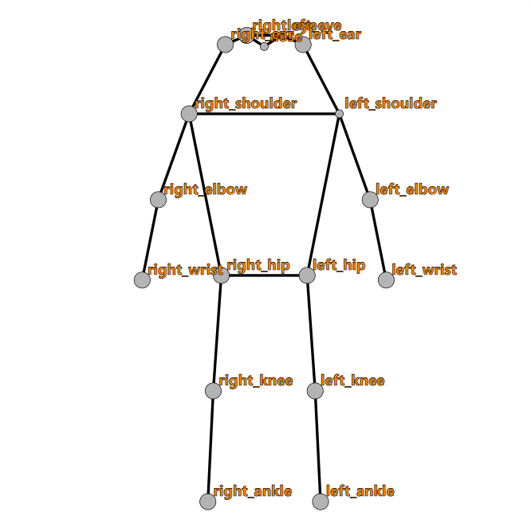
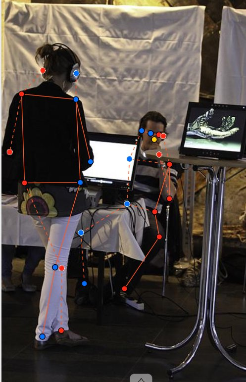
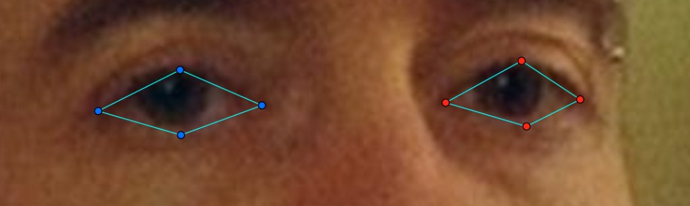
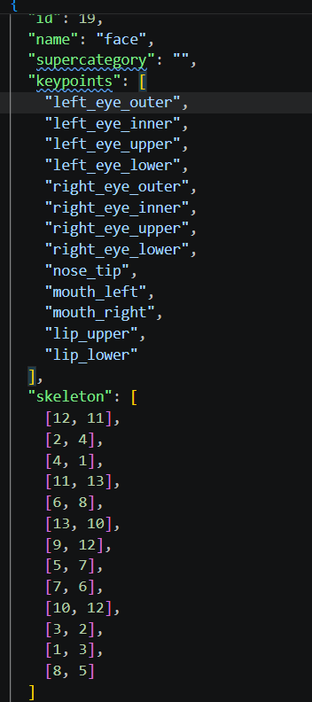

# Báo cáo cá nhân — NguyenHuyVuong-2A202603133

Đổi tên file theo quy tắc `MSSV_HoTen.md`. Ví dụ: `20241234_NguyenVanAn.md`.

Dữ liệu: 12 ảnh người COCO val2017 (Lin et al., 2014) và 8 ảnh chân dung Wikimedia Commons, chỉ dùng trong lớp.

## 0. Thông tin học viên

- Họ tên: Nguyen Huy Vuong
- MSSV: 2A202603133
- Email: vuongvnbn1@gmail.com
- Link repository: https://github.com/Virgoboyy/K5-L2A-DAY04-NguyenHuyVuong-2A202603133-KeypointPose-Student.git
- Phiên bản CVAT (Help → About): 2.82
- Máy: hệ điều hành Windows · RAM 16 GB · chạy CVAT chế độ đầy đủ
- Bộ ảnh (`src/exports/assignment.json` do `lab.py setup` tạo): có
- Giờ bắt đầu: 17:10
- Giờ kết thúc: 22:30 

## 1. Kiểm tra label (CP0)

| Label | Kiểu | Số điểm | Tên điểm đúng bảng của lab? | Đúng thứ tự? | Số cạnh |
|---|---|---:|---|---|---:|
| `person` | Skeleton | 17 | Có | Có | 19 |
| `face` | Skeleton | 13 | Có | Có | 13 |

Mẫu `person` dựng theo người quay mặt về camera (các điểm `left_*` nằm bên phải khung mẫu)? Có

Cách đổi cờ `occluded` / `outside` cho **một điểm** trên phiên bản CVAT này (một câu):

Rê chuột vào điểm đó rồi nhấn phím Q để đổi thành occluded (v = 1, viền rỗng nét đứt) hoặc nhấn phím O để đổi thành outside (v = 0, ẩn điểm khỏi ảnh).

## 2. Số lượng đã gán và thời gian (CP1, CP2)

| Nhóm ảnh | Số ảnh | Số skeleton đã gán | Số người dưới 60 px (không gán) | Số poster / gương / màn hình bỏ qua | Thời gian (phút) |
|---|---:|---:|---:|---:|---:|
| `easy` | 5 | 5 | 0 | 0 | 25 |
| `occluded` | 3 | 6 | 1 | 0 | 25 |
| `back` | 2 | 3 | 0 | 0 | 18 |
| `small` | 1 | 1 | 2 | 0 | 10 |
| `crowd` | 1 | 3 | 4 | 0 | 18 |
| `faces` | 8 | 8 | — | 0 | 25 |

- Số ảnh người đã xong ở mốc phút 105: 10 / 10
- Thời gian thực tế (phút): CP1 96 · CP2 25 · CP3 20
- Ảnh tốn thời gian nhất là ảnh nào, vì sao?

Ảnh crowd `000000413160.jpg` tốn thời gian nhất vì có nhiều người đứng chen chúc, nhiều người phía sau có chiều cao dưới 60 px cần phải đo và ước lượng kỹ để loại bỏ, đồng thời các chi của người ở tiền cảnh bị che khuất và đan xen nhau cần dò cẩn thận từng khớp từ vai xuống cổ tay và từ hông xuống cổ chân.

## 3. Bảng ca khó (CP1, CP2)

Mỗi điểm bạn phân vân một dòng, nhất là phân vân giữa `v = 1` và `v = 0`, hoặc không chắc hướng người.

| Ảnh | Người / mặt | Điểm | Cờ đã chọn | Phân vân giữa | Lý do chọn |
|---|---|---|---:|---|---|
| `000000163118.jpg` | Người quay lưng | `nose`, `left_eye`, `right_eye` | 0 | v = 0 và v = 1 | Người quay lưng hoàn toàn, mặt bị hộp sọ che khuất không thấy và không thể ước lượng chắc chắn, để outside |
| `000000188804.jpg` | Người nghiêng | `right_eye`, `right_ear` | 0 | v = 0 và v = 1 | Người đứng nghiêng profile (~90 độ), mắt và tai phải nằm hẳn ở nửa mặt bên kia bị khuất hoàn toàn |
| `000000147780.jpg` | Người nghiêng nhẹ | `left_ear` | 1 | v = 1 và v = 0 | Người nghiêng góc nhẹ, tai trái bị má/mặt che khuất (tự che) nhưng ước lượng được chắc chắn vị trí chân tai sau góc hàm |

## 4. Bảng tự review (CP3)

Đi từ ảnh cuối về ảnh đầu. 5 ảnh người (ít nhất 2 ảnh `back` hoặc `crowd`) và 3 ảnh mặt. Ít nhất 8 dòng, kể cả dòng `ok`. Ghi lỗi trước, sửa sau.

Mã lỗi dùng đúng một trong: `lr_swap`, `vis_flag`, `position`, `missing`, `extra`, `ok`.

| Ảnh | Người / mặt | Điểm | Mã lỗi | Ghi chú | Đã sửa? |
|---|---|---|---|---|---|
| `000000413160.jpg` (crowd) | Người 1 | `left_wrist` | `position` | Cổ tay bị mờ do chuyển động, đặt lệch mép bàn tay; đã phóng to chỉnh lại vào tâm khớp | Có |
| `000000413160.jpg` (crowd) | Người 2 | Toàn bộ | `ok` | Các khớp thân và chân đặt chuẩn xác, không có lỗi | Có |
| `000000359340.jpg` (back) | Người 1 | Cụm `left_*`, `right_*` | `lr_swap` | Ban đầu để nguyên mẫu theo người quay mặt; đã đảo cụm left sang bên trái ảnh | Có |
| `000000163118.jpg` (back) | Người 2 | Cặp `ankle` | `ok` | Người bước chéo chân tự nhiên, đã kiểm tra đúng chân trái/phải không phải lỗi swap | Có |
| `000000188804.jpg` (occluded) | Người 2 | `right_eye`, `right_ear` | `vis_flag` | Ban đầu kéo điểm đè lên mặt v = 1; đã sửa lại ấn O (outside, v = 0) do khuất hoàn toàn | Có |
| `face_505385.jpg` (kính râm) | Mặt 1 | 8 điểm mắt | `vis_flag` | Mắt sau kính râm tối ban đầu để v = 2; đã bật occluded (v = 1) cho cả 8 điểm mắt | Có |
| `face_196742.jpg` (mặt nghiêng) | Mặt 1 | `nose_tip`, `mouth_*` | `ok` | Khóe miệng và chóp mũi đặt chính xác ở mép viền giải phẫu | Có |
| `face_125051.jpg` (mặt thẳng) | Mặt 1 | `*_eye_upper`, `*_eye_lower` | `position` | Mí trên và mí dưới bị lệch ra lông mi; đã phóng to đặt lại ngay giữa mép mí trên/dưới | Có |

Tổng hợp số lỗi theo mã:

| `lr_swap` | `vis_flag` | `position` | `missing` | `extra` | `ok` |
|---:|---:|---:|---:|---:|---:|
| 1 | 2 | 2 | 0 | 0 | 3 |

Điểm còn phân vân giữa `v = 1` và `v = 0` (ghi cả hai lựa chọn và lý do chọn):

Các điểm khớp chân bị che một phần bởi vật cản trong nhóm `occluded`: chọn `v = 1` khi dựa vào hướng của cẳng chân/đùi có thể ước lượng vị trí khớp trong phạm vi hẹp; chọn `v = 0` khi bị vật cản lớn che hoàn toàn thân dưới.

## 5. Kiểm file xuất và kết quả tự kiểm (CP4)

Tự kiểm tay trong file JSON:

| File | Người / mặt kiểm (ảnh, thứ tự) | Số phần tử `keypoints` | Điểm `outside` ra `v = 0`, `occluded` ra `v = 1`? | `num_keypoints` khớp? |
|---|---|---:|---|---|
| `NguyenHuyVuong_persons.zip` | 000000057978.jpg, người 1 | 51 | Có | Có |
| `NguyenHuyVuong_persons.zip` | 000000163118.jpg, người 2 | 51 | Có | Có |
| `NguyenHuyVuong_faces.zip` | face_125051.jpg, mặt 1 | 39 | Có | Có |

Sau khi xuất, CVAT ghi `occluded` thành `v = 1` và `outside` thành `v = 0`. Tọa độ của điểm `outside` trong file là tọa độ cũ (CVAT 2.x giữ nguyên tọa độ cũ, chuẩn COCO ghi 0, 0; không ảnh hưởng vì v=0 bị bỏ qua khi huấn luyện).

Hai job đã chuyển sang completed trên CVAT? Có

Dán phần **TÓM TẮT** in ra từ `src/check_submission.py`:

```text
- File person: NguyenHuyVuong_persons.zip
  Số ảnh: 12 · số skeleton `person`: 18 · mỗi annotation 51 số
  Skeleton theo ảnh: 000000057978=1, 000000072098=1, 000000147780=2, 000000156069=1, 000000163118=2, 000000188804=2, 000000336477=1, 000000359340=1, 000000413160=3, 000000438099=1, 000000463932=1, 000000580257=2
  Cờ v: v=2 216 (71%) · v=1 43 (14%) · v=0 47 (15%)
  num_keypoints trung bình: 14.4
- File face: NguyenHuyVuong_faces.zip
  Số ảnh: 8 · số skeleton `face`: 8 · mỗi annotation 39 số
  Skeleton theo ảnh: face_125051=1, face_155465=1, face_196742=1, face_232598=1, face_294580=1, face_415073=1, face_505385=1, face_560526=1
  Cờ v: v=2 87 (84%) · v=1 9 (9%) · v=0 8 (8%)
  num_keypoints trung bình: 12.0
- Ghi chú: 55 điểm v = 0 vẫn mang tọa độ cũ (CVAT 2.x xuất như vậy; chuẩn COCO ghi 0, 0). Không phải lỗi: điểm v = 0 bị bỏ qua khi huấn luyện và khi chấm.
- Số [LỖI]: 0 · số [CẢNH BÁO]: 3
Kết quả: ĐẠT (đọc lại từng cảnh báo ở trên)
```

Các `[CẢNH BÁO]` còn giữ nguyên và lý do:

Các cảnh báo về cặp ankle nằm ngược phía ở ảnh 000000163118.jpg (#2), 000000188804.jpg (#2), 000000580257.jpg (#1): Trong thực tế nhân vật đang bước đi hoặc ngồi bắt chéo chân tự nhiên nên cổ chân trái và cổ chân phải bắt chéo nhau. Đã đối chiếu kỹ các khớp gối và hông cùng bên, vị trí khớp giải phẫu hoàn toàn chuẩn xác, không phải lỗi đổi trái/phải (`lr_swap`).

## 6. Ảnh chụp màn hình

1. Label `person` trong label constructor (đủ 17 điểm có tên):

   

2. Một người quay lưng đã gán, cờ đã đặt:

   

3. Một khuôn mặt đã gán 13 điểm, phóng to vùng mắt:

   

4. Một đoạn JSON xuất của một người:

   

Nguồn ảnh: COCO val2017 / Wikimedia Commons.

## 7. Tự đánh giá

1. Lỗi bạn mắc nhiều nhất hôm nay, và cách bạn sẽ tránh ở dự án thật:

   Lỗi dễ mắc nhất là phản xạ nhầm trái/phải đối với người quay lưng (`back`), cùng với việc phân vân cờ visibility (`v = 1` và `v = 0`) ở các khớp bị che khuất hoặc góc nghiêng. Ở dự án thật, tôi sẽ luôn nói to hướng của nhân vật trước khi kéo điểm, đảo ngay cụm left sang bên trái ảnh trước khi tinh chỉnh; đồng thời tuân thủ nghiêm ngặt 4 câu hỏi visibility, kiên quyết bật outside (`v = 0`) cho các điểm ngoài khung ảnh hoặc không đoán được chắc chắn chứ không đoán bừa.

2. Một quy tắc bạn đề xuất thêm vào guideline (kèm ảnh ví dụ nếu có):

   Đề xuất bổ sung hướng dẫn và ảnh minh họa cho trường hợp người ngồi co chân hoặc bước chéo chân khiến hai cổ chân (`ankle`) vắt chéo nhau tự nhiên. Điều này giúp người gán phân biệt rõ ràng giữa tư thế tự nhiên ngoài thực tế và lỗi đổi nhầm cặp trái/phải (`lr_swap`), tránh mất thời gian băn khoăn khi script kiểm tra đưa ra cảnh báo.

3. Nhãn của bạn đi vào model ở đâu? Chọn một lỗi bạn đã sửa và nói nó sẽ làm model học sai thế nào (heatmap, trọng số trong loss, hay bước lật ảnh):

   Nhãn đi vào mô hình ở 3 khâu chính: Heatmap ground-truth (đỉnh Gauss tại tọa độ khớp), trọng số trong hàm loss (v=0 trọng số 0, v=1,2 trọng số 1), và bước lật ảnh khi tăng cường dữ liệu (horizontal flip).
   Ví dụ với lỗi `lr_swap` ở người quay lưng: Khi huấn luyện, kỹ thuật lật ảnh ngang sẽ đảo tọa độ x' = W - x và tự động hoán đổi nhãn `left_*` và `right_*`. Nếu gán sai trái/phải theo góc nhìn người xem, sau khi lật ảnh nhãn sẽ bị mâu thuẫn hoàn toàn với giải phẫu thật, phá vỡ phân phối dữ liệu học và làm sụt giảm OKS nghiêm trọng.

## 8. Khó khăn và lỗi kỹ thuật

Không gặp sự cố kỹ thuật nghiêm trọng với CVAT. Hệ thống chạy ổn định, việc export file và chạy script tự kiểm tra `check_submission.py` diễn ra trơn tru, đạt kết quả ĐẠT với 0 lỗi ngay từ lần xuất đầu tiên.

## 9. Tài liệu tham khảo và công cụ AI đã dùng

- Hướng dẫn COCO Keypoint Dataset (Lin et al., 2014) và CVAT Documentation.
- Trợ lý AI (Antigravity): Hỗ trợ tra cứu lý thuyết về Object Keypoint Similarity (OKS), giải thích quy tắc 4 câu hỏi cờ visibility và phân tích các cảnh báo của script tự kiểm tra.

## Bonus (nếu làm)

### B1 — 3 ảnh người khó thêm

| Ảnh | Số skeleton | Số người dưới 60 px | Ca khó nhất |
|---|---:|---:|---|
| | | | |
| | | | |
| | | | |

Kết quả `src/check_submission.py` cho `HoVaTen_bonus_persons.zip`:

```text
(dán ở đây)
```

### B2 — 5 ảnh khuôn mặt đen trắng / hồng ngoại

Ảnh không màu khó hơn ở điểm nào? Kính râm trên ảnh hồng ngoại có còn là `v = 1` không?

...

### B3 — Model so với nhãn của tôi (không tính điểm)

- Demo đã dùng:
- Ảnh đã thử:

1. Model có trả điểm cho khớp bị che, hay khớp ngoài ảnh không? Confidence ở các điểm đó thế nào?

   ...

2. Với người quay lưng, model có đổi trái/phải không?

   ...

3. Bộ điểm của model có giống 17 điểm COCO không?

   ...

## 9. Tài liệu tham khảo và công cụ AI đã dùng

- Hướng dẫn COCO Keypoint Dataset (Lin et al., 2014) và CVAT Documentation.
- Trợ lý AI (Antigravity): Hỗ trợ tra cứu lý thuyết về Object Keypoint Similarity (OKS), giải thích quy tắc 4 câu hỏi cờ visibility và phân tích các cảnh báo của script tự kiểm tra.
